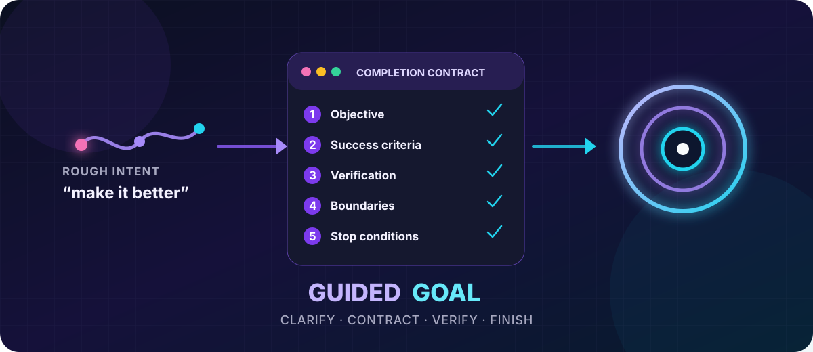

<div align="center">
  

  # Guided Goal for Hermes Agent

  **Turn “make this better” into a goal an agent can actually finish.**

  [](https://github.com/luchasarie/hermes-guided-goal/actions/workflows/test.yml)
  [](https://github.com/NousResearch/hermes-agent)
  [](LICENSE)
  [](https://www.python.org/)
</div>

---

Rough prompts are easy to start and hard to finish. Guided Goal adds a short interview before Hermes native `/goal` mode. It asks only the questions that materially change the work, writes a deterministic completion contract, gets explicit confirmation, and then activates the real autonomous goal loop.

```text
/guided-goal improve our flaky test situation

Hermes: Which test suite should define success, and what failure rate is acceptable?
You: The API integration suite; zero flakes across 10 consecutive runs.

Hermes: [presents Objective, Success criteria, Verification,
         Boundaries, and Stop conditions]
        Activate this goal?
You: Yes.

Hermes: Goal activated. Work begins immediately.
```

## What it fixes

Without a contract, an agent can keep polishing forever, stop after a plausible-looking change, or quietly broaden the scope. Guided Goal makes five things explicit before autonomous work begins:

1. **Objective** — one bounded outcome.
2. **Success criteria** — binary or deterministic completion conditions.
3. **Verification** — exact commands, checks, artifacts, or observable evidence.
4. **Boundaries** — allowed scope and an explicit denylist.
5. **Stop conditions** — a numeric attempt/turn cap plus escalation rules.

## Features

- One short question per response; at most six by default.
- Preserves facts already supplied instead of interviewing from scratch.
- Pushes back on subjective quality, missing verification, and unbounded iteration.
- Requires an explicit **“Activate this goal?”** confirmation.
- Activates Hermes's native `GoalManager`; it does not build a parallel task loop.
- Works in the interactive CLI and Hermes gateways such as Discord and Telegram.
- Refuses to replace an active or paused goal.
- Validates all five contract sections and a numeric attempt cap before activation.
- No API keys, network calls, background services, or third-party dependencies.

## Install

You need [Hermes Agent](https://hermes-agent.nousresearch.com/docs/) with native `/goal` support and the general plugin API. The plugin is tested against Hermes Agent `0.20.0`.

```bash
hermes plugins install luchasarie/hermes-guided-goal --enable
```

Start a new Hermes session after installation so plugin commands and tools are reloaded.

Verify the installation:

```bash
hermes plugins list --plain --no-bundled
```

You should see `guided-goal` as enabled.

## Usage

Start with a rough objective:

```text
/guided-goal ship the parser fix without breaking the public API
```

Or start blank and let the interview establish the objective:

```text
/guided-goal
```

During the interview, answer normally. The plugin does **not** inspect files, run tools, or begin work before confirmation. Once the contract is ready, Hermes shows it and asks:

```text
Activate this goal?
```

Reply with an explicit yes. The plugin validates the contract, persists it through Hermes native goal mode, and the agent begins work in the same session.

### Existing goals

Guided Goal will not overwrite an active or paused goal. Use the native controls first:

```text
/goal status
/goal resume
/goal clear
```

Then run `/guided-goal` again.

## How it works

```text
rough intent
    │
    ▼
short guided interview
    │
    ▼
five-section completion contract
    │
    ▼
explicit user confirmation
    │
    ▼
guided_goal_activate
    │
    ▼
Hermes native GoalManager → autonomous work + native goal judge
```

The plugin exposes three narrow surfaces:

| Surface | Purpose |
| --- | --- |
| `/guided-goal` | Starts the interview in CLI sessions. |
| `pre_gateway_dispatch` | Rewrites the gateway slash command into the same interview turn. |
| `guided_goal_activate` | Validates and activates the confirmed contract through native goal state. |

The interview prompt lives in [`guided-goal-interview.md`](guided-goal-interview.md), so the contract policy is easy to audit and adapt.

## Safety model

Guided Goal intentionally separates **clarification** from **execution**:

- No tools may run during the interview.
- Activation requires explicit confirmation.
- The contract must contain verification and scope boundaries.
- Every activated goal has a finite attempt/turn cap between 1 and 100.
- Existing goals are never silently replaced.
- Activation failures return structured JSON instead of crashing the Hermes turn.

Like every Hermes plugin, installed code runs with the same trust as Hermes itself. Review the source before enabling third-party plugins.

## Development

Clone the repository and run the tests with the Python environment that contains Hermes Agent:

```bash
git clone https://github.com/luchasarie/hermes-guided-goal.git
cd hermes-guided-goal
python -m pip install -r requirements-dev.txt
python -m pytest --rootdir=tests tests -q
```

The test suite covers CLI injection, gateway rewriting, contract parsing, explicit caps, native goal mapping, active-goal protection, gateway session IDs, and fail-closed host API errors.

See [CONTRIBUTING.md](CONTRIBUTING.md) for the contribution workflow.

## Project status

`v0.1.0` is the first public release. It is small by design: one command, one activation tool, one gateway hook, and Hermes native goal mode underneath.

## License

[MIT](LICENSE) © 2026 Luchas Arie.
